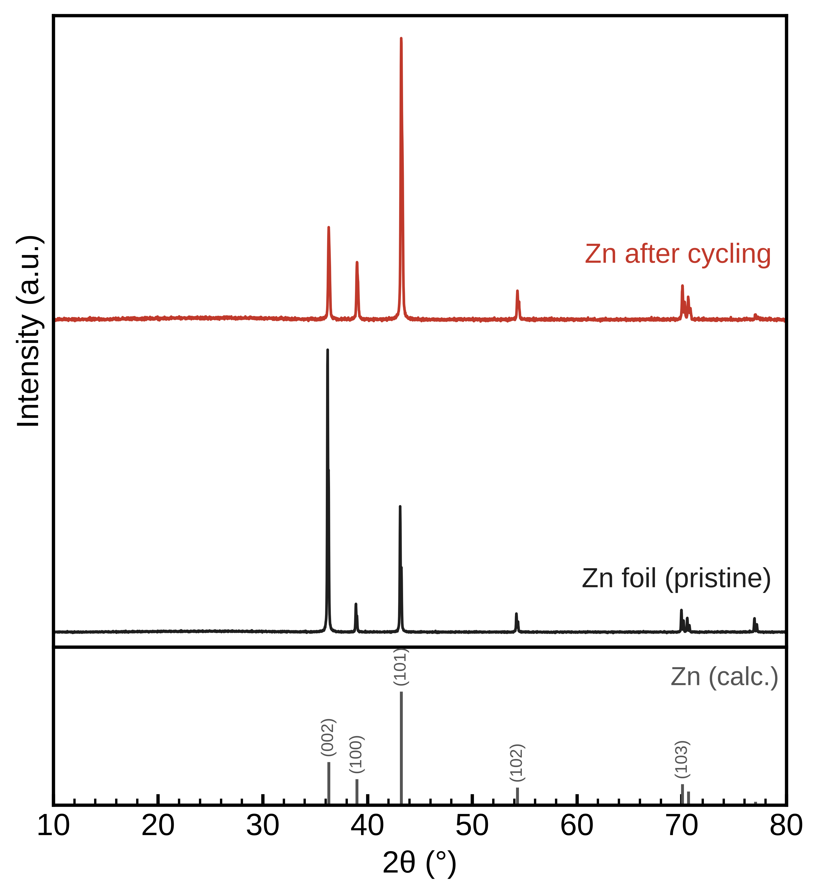

# xrd-analysis

**XRD 数据一键分析与论文作图：任何 AI 都能用，不用 AI 也能用。**

One-click powder XRD analysis and publication plots. Works as an Agent Skill (Claude, Codex, Copilot and other tools that read `SKILL.md`), as a command-line tool, or as a drag-and-drop browser app.



*示例：锌箔循环前后（`examples/` 中的模拟数据），底部为由 CIF 计算的 Zn 标准衍射线，自动标注晶面。*

## 它能做什么

把衍射仪导出的文件丢进去，自动得到：

| 输出 | 内容 |
|---|---|
| 📊 论文风格堆叠图（PNG 600 dpi / PDF） | 多样品错开堆叠，图例贴在曲线右端，底部参考卡片竖线 + (hkl) 标注，支持中文图例 |
| 📈 Origin 作图脚本 | 数据已嵌入，Origin 2021+ 里运行即出图（默认 Arial 36 号、边框 3 pt） |
| 📄 Excel | 前 3 行为 Long Name / Units / Comments，可直接导入 Origin；另含峰表、物相匹配、织构系数 |
| 🔍 分析报告 | 峰位、d 值、半峰宽、晶粒尺寸、物相匹配、峰位偏移原因、织构系数、强度比、数据质量检查 |

### 支持的文件

- 理学 Rigaku：SmartLab 导出的 `.txt` / `.ras`、`.rasx`、二进制 `.raw`
- 布鲁克 Bruker：`.raw`（v1、v3）
- 通用：两列 `.xy` / `.txt` / `.csv`、`.xlsx`

格式按文件内容自动识别。给一个文件夹时，同一次测量的多个导出文件只取一个。

### 自动完成的分析

- **寻峰与拟合**：SNIP 扣背景，按实际峰宽自适应平滑，pseudo-Voigt 拟合；Cu Kα1/Kα2 双峰按双峰模型拟合，不会把 Kα2 当成新峰。
- **自动物相识别（检索匹配）**：不给参考也能用。程序会拿样品的峰去比对候选物相，给出最可能的物相组合、排名表和没有被解释的峰，并把识别出的物相自动画到图底部。候选物相有三个来源：
  - **内置库**：34 种常用物相，包括集流体与金属、锂电/锌电电极材料、常见催化剂氧化物。不用联网，`--list-library` 可以查看清单。
  - **COD 在线检索**：`--search Zn,O,S,H` 会下载由这些元素组成的所有已知结构，算出标准谱后逐一打分。COD 是公有领域的开放数据库，下载过的结构会缓存在本地。第一次检索要下载结构，需要几分钟；连不上 COD 时程序会提示，并自动改用内置库。网页界面左侧栏也可以直接填元素进行检索。
  - **你自己的参考**：CIF 文件，或 Jade/HighScore 导出的 PDF 卡片峰表，用 `--ref` 传入。
- **物相匹配**：针对指定的参考给出匹配得分、缺失的强峰和无法解释的峰，会先扣除整体的零点或样品高度偏移再判断。
- **峰位偏移诊断**：判断整体偏移更像零点误差（常数）、样品高度误差（∝cosθ）还是真实晶格变化（∝tanθ，并给出 Δd/d）。
- **晶粒尺寸**：Scherrer 公式，可扣除仪器展宽。
- **织构系数 TC(hkl)**：如锌负极的 (002) 择优取向。
- **强度比**：如层状正极 I(003)/I(104)、锌负极 I(002)/I(101)，可按晶面或 2θ 指定。
- **质量检查**：信噪比低、步长太粗、非晶包、荧光背景，以及未归属峰是否来自集流体或基底（Cu/Al/Ni/Ti/Zn 箔、碳纸、不锈钢、Si）。

## 准确性验证

自动物相识别用一组**已发表的实测数据**做过盲测：XRD-AutoAnalyzer（Szymanski 等，*npj Comput. Mater.* 2021）公开的 8 张实测谱，其中包含两相、三相混合物，标准答案写在文件名里。候选物相是该项目提供的 56 个结构。

| 样品 | 真实物相 | 本工具识别结果 |
|---|---|---|
| Li2MnO3+MnO+TiO2 | 3 相 | MnO + TiO₂ + Li₂MnO₃ ✅ |
| Mn2O3+LiF | 2 相 | Mn₂O₃ + LiF ✅ |
| TiO2+MnO | 2 相 | MnO + TiO₂ ✅ |
| LiMnO2 / Mn2O3 / MnO / MnO2 / TiO2 | 单相 | 全部正确 ✅ |

**12 个物相全部识别出来，0 个误报。** 这组参考结构来自理论计算，晶胞与实测有 1%～2% 的偏差，程序会自动修正：先扣除零点和样品高度误差，再按晶系精修 a、c 轴的晶胞参数。复现方法见 `tools/benchmark_autoanalyzer.py`。

当然，8 个样品的测试集规模还小，欢迎提交你的数据和 Jade 的识别结果来扩充测试。

## 三种用法

### 1. 浏览器界面（不用命令行）

装好 Python 3.9+ 后，双击：

- Windows：`start_gui_windows.bat`
- macOS / Linux：`start_gui_mac_linux.sh`

浏览器会打开一个页面：拖入数据文件（CIF 可选），填图例，点“开始分析”，最后下载全部结果。想联网识别物相，就在左侧栏“物相识别”里填样品含有的元素，例如 `Zn,S,O,H`。数据只在你自己的电脑上处理，联网时只会从 COD 下载晶体结构。

### 2. 命令行

```bash
pip install -r xrd-analysis/scripts/requirements.txt
# macOS / Linux 如提示 externally-managed-environment，先建虚拟环境：
#   python3 -m venv .venv && . .venv/bin/activate

# 两个样品 + CIF 参考，计算 I(002)/I(101)
python xrd-analysis/scripts/xrd.py examples/Zn_foil_pristine.xy examples/Zn_after_cycling.xy \
       --names "Zn foil" "Zn after cycling" --ref examples/Zn.cif --ratio 002/101

# 整个文件夹，限定 2θ 范围
python xrd-analysis/scripts/xrd.py D:/data/xrd/20260104 --range 5 60

# 不给参考：自动用内置库识别物相
python xrd-analysis/scripts/xrd.py D:/data/xrd/zm-5.txt

# 联网到 COD 按元素检索（例如锌电池副产物：Zn、S、O、H 组成的所有已知结构）
python xrd-analysis/scripts/xrd.py sample.txt --search Zn,S,O,H

# 直接用某个 COD 编号的结构做参考，画成“计算谱”曲线样式
python xrd-analysis/scripts/xrd.py mof.xy --cod 1234567 --style profile --range 2 15

# 改图例、颜色、顺序、字号后重画
python xrd-analysis/scripts/xrd.py --config D:/data/xrd/20260104/xrd_output/config.json
```

常用参数见 `python xrd-analysis/scripts/xrd.py -h`。

### 3. 作为 AI Agent Skill

`xrd-analysis/` 文件夹是一个符合 [Agent Skills](https://agentskills.io) 开放标准的 skill（`SKILL.md` + `scripts/` + `references/`）。所有计算都由 Python 程序完成，换哪个 AI 结果都一样；AI 负责调用程序、检查图、解释结果。

把 `xrd-analysis/` 整个文件夹复制到对应位置：

| 工具 | 位置 |
|---|---|
| Claude Code | `~/.claude/skills/xrd-analysis/`（或项目内 `.claude/skills/`） |
| Claude 网页 / 桌面端 | 把 `xrd-analysis` 文件夹压缩成 ZIP，在 Customize → Skills 中上传 |
| OpenAI Codex CLI | `~/.agents/skills/xrd-analysis/`（或项目内 `.agents/skills/`） |
| GitHub Copilot | 项目内 `.github/skills/` 或 `.agents/skills/` |
| 其他支持 SKILL.md 的工具 | 放到该工具文档中的 skills 目录 |

装好后发送数据文件，说“分析一下这几个 XRD”或“画成论文图，参考用这个 CIF”即可。

## 参考卡片从哪来

- **自动**：内置库（离线）或 `--search` / `--cod`（COD 在线，免费）。
- **CIF**：[COD](https://www.crystallography.net)、Materials Project、ICSD/CCDC，或文献的 SI。MOF 等复杂结构通常在 CCDC 或文章附件里。
- **PDF 卡片峰位**：在 Jade/HighScore 中把卡片峰表导出为文本（2θ 或 d、强度、h k l），用 `--ref` 传入。本项目不附带 ICDD 的 PDF 卡片（商业数据库）。

内置库的结构按标准晶体学数据写成，`tools/build_builtin_library.py` 会自动核对每个物相的峰位和最强峰。强度是计算值，与实测或卡片强度会有差异。

## 说明与局限

- 检索匹配给出的是候选物相，依据是峰位，不是 Rietveld 精修。请结合元素组成和其他表征确认；相含量、精确晶胞参数请用 GSAS-II、FullProf 等。
- 由 CIF 计算的是理想粉末谱：不含择优取向，强度与实测或卡片会有差异。
- 晶粒尺寸未扣除仪器展宽时只能作为下限，样品之间相对比较更可靠。
- Origin 脚本中个别格式命令在不同版本中支持程度不同：失败时只打印提示，不影响出图。
- 计划中：原位 XRD 等高线图（配合充放电曲线）、更多仪器格式。欢迎在 Issues 里提交你的仪器格式样例。

## 仓库结构

```
├── xrd-analysis/            Agent Skill（复制这个文件夹即可）
│   ├── SKILL.md
│   ├── scripts/
│   │   ├── xrd.py           命令行入口
│   │   ├── app.py           浏览器界面
│   │   └── xrdtool/         读取、处理、寻峰、物相、作图、导出
│   └── references/          示例 CIF + 内置物相库 (library/)
├── examples/                模拟示例数据
├── tools/                   内置物相库生成与自检脚本
├── docs/                    README 图片
├── start_gui_windows.bat
└── start_gui_mac_linux.sh
```

## License

MIT
